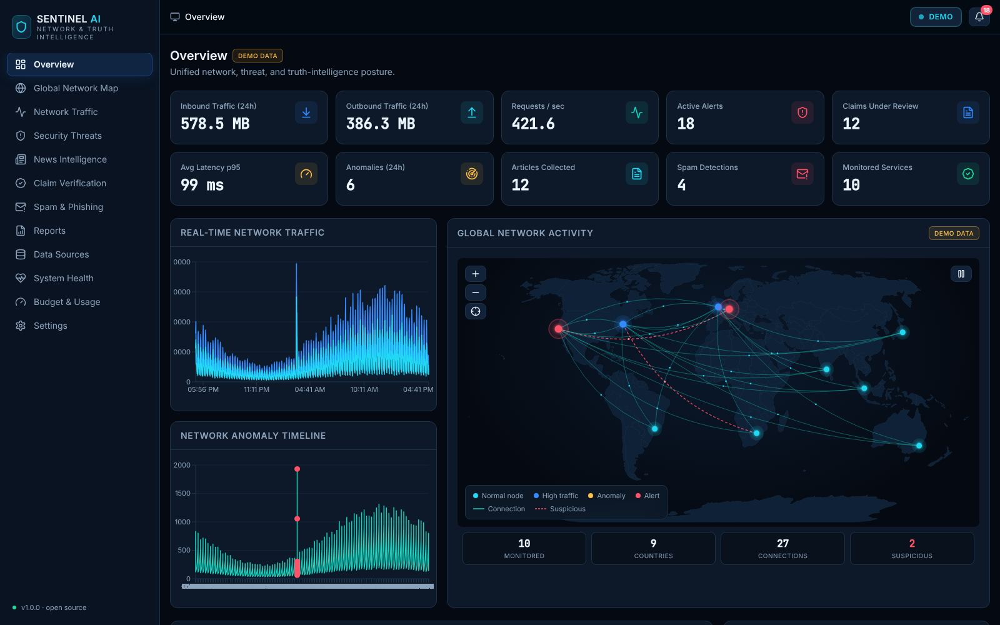
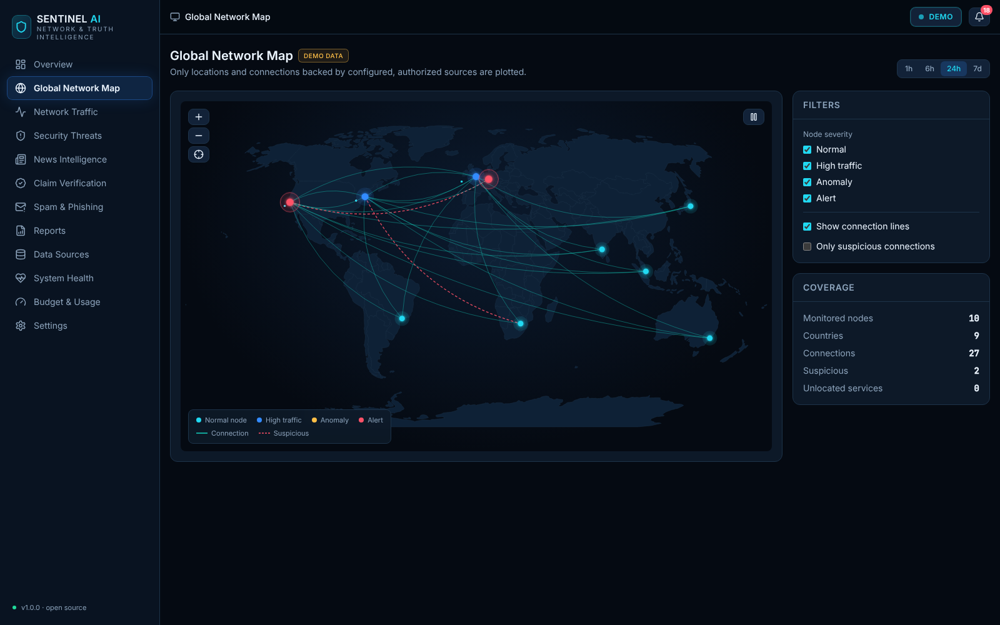
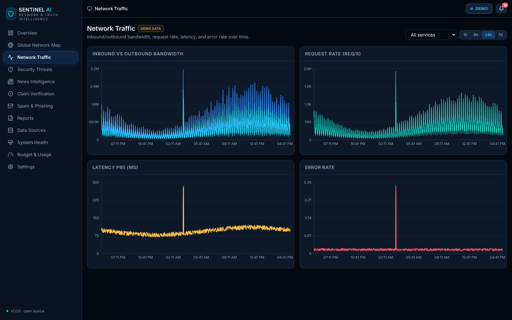
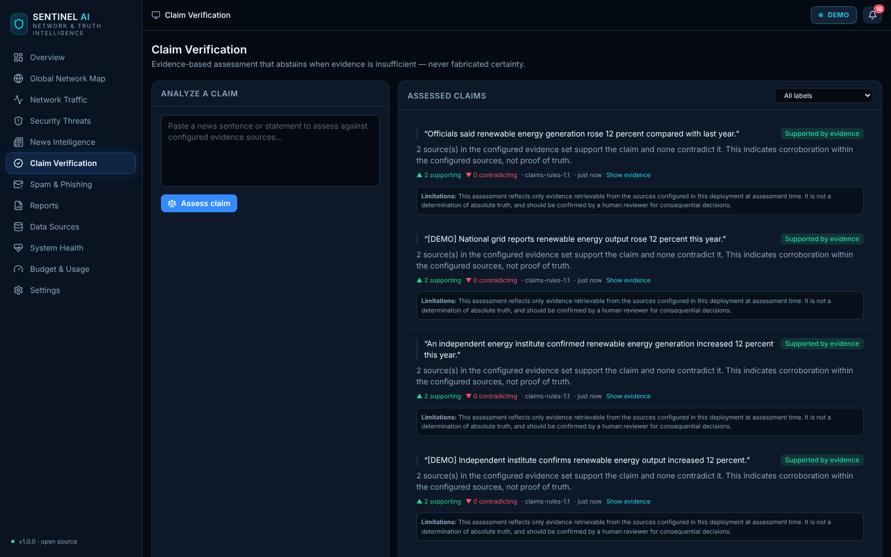
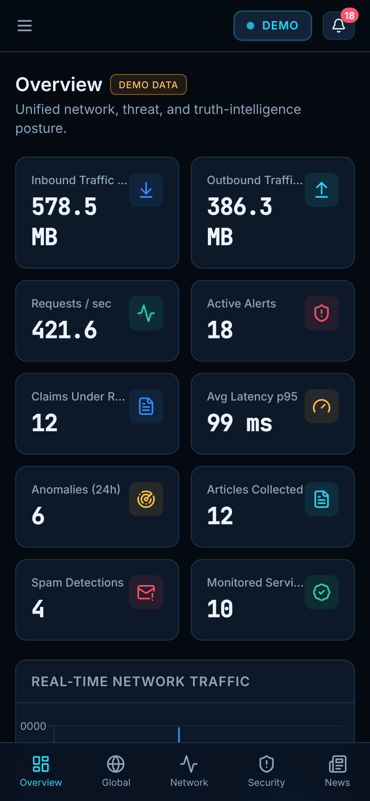
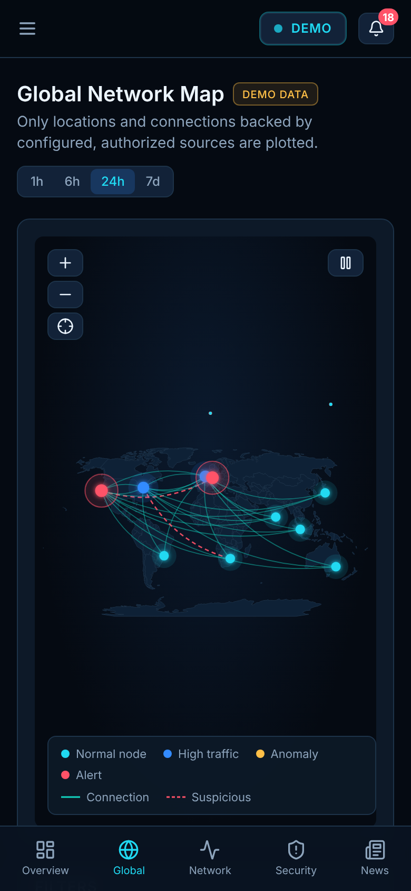

<div align="center">


# SENTINEL AI
### Network &amp; Truth Intelligence

A practical, open-source platform for **authorized network monitoring**, **statistical anomaly detection**, **news intelligence**, **evidence-based claim assessment**, and **spam/phishing analysis** — presented in a premium security-operations-center dashboard with an interactive global network map.

</div>

---

> **Honesty first.** Sentinel AI never claims to determine the absolute truth of a
> claim. It abstains when evidence is insufficient. It never fabricates live
> traffic, articles, citations, or deployment results. Demonstration data is
> always clearly labelled **DEMO DATA** and is never silently substituted for
> live data.

## Screenshots

> Captured from the running app against the live backend (demo data).

| Overview | Global Network Map |
|---|---|
|  |  |

| Network Traffic | Claim Verification |
|---|---|
|  |  |

<p align="center"> &nbsp; </p>

## What it does

| Module | Status | Notes |
|---|---|---|
| Network metric ingestion (HTTP push + Prometheus) | ✅ Working | Authorized services only |
| Traffic aggregation + charts | ✅ Working | Inbound/outbound, rps, latency, error rate |
| Global network map | ✅ Working | d3-geo, zoom/pan, animated arcs, event-backed nodes |
| Statistical anomaly detection | ✅ Working | Rolling z-score + optional IsolationForest |
| Persistent alerts (dedup + cooldown + ack) | ✅ Working | |
| RSS news ingestion | ✅ Working | Live feeds; respects source terms |
| Supported news/fact-check APIs | ⚙️ Interface ready | Requires API keys (NewsAPI, Google Fact Check) |
| Article dedup + story grouping | ✅ Working | Distinct-publisher diversity |
| Claim extraction + evidence assessment | ✅ Working | Deterministic; abstains on weak evidence |
| Spam / phishing analysis | ✅ Working | Explainable; URLs never auto-visited |
| System health monitoring | ✅ Working | Per-component status |
| Budget / usage tracking | ✅ Working | Fail-closed; estimates clearly labelled |
| Reports & history | ✅ Working | |
| PWA (installable, offline shell) | ✅ Working | NetworkOnly for `/api` |

See **[docs/REPORT.md](docs/REPORT.md)** for a full, honest implementation &amp; test report.

## Tech stack

- **Frontend:** React 18, TypeScript, Vite, Tailwind CSS, Recharts, d3-geo (map), vite-plugin-pwa
- **Backend:** Python 3.12+, FastAPI, SQLAlchemy 2, Alembic, scikit-learn, feedparser
- **Database:** PostgreSQL (production) · SQLite (local/dev/tests)
- **Infra:** Docker Compose, Prometheus-compatible `/metrics`, structured JSON logs

## Quick start (local, zero config)

The backend defaults to SQLite, so you can run it with no database setup.

**Backend**
```bash
cd backend
python3 -m venv .venv && source .venv/bin/activate
pip install -r requirements-dev.txt
export SECRET_KEY=$(python -c "import secrets; print(secrets.token_urlsafe(48))")
export ADMIN_PASSWORD=change-me
uvicorn app.main:app --reload --port 8000
```
API docs: http://localhost:8000/docs

**Frontend**
```bash
cd frontend
npm install
npm run dev
```
Dashboard: http://localhost:5173 (the dev server proxies `/api` → `:8000`)

**Load demo data** — sign in via the dashboard **Settings** page with your
`ADMIN_USERNAME` / `ADMIN_PASSWORD`, then click **Generate demo data**, or:
```bash
TOKEN=$(curl -s -X POST localhost:8000/api/auth/token -d "username=admin&password=change-me" | python3 -c "import sys,json;print(json.load(sys.stdin)['access_token'])")
curl -X POST localhost:8000/api/admin/demo/generate -H "Authorization: Bearer $TOKEN"
```

## Quick start (Docker Compose — Postgres + API + web)

```bash
cp .env.example .env     # then set SECRET_KEY and ADMIN_PASSWORD
docker compose up --build
```
- Dashboard → http://localhost:8080
- API → http://localhost:8000

## Testing

```bash
cd backend && source .venv/bin/activate
pytest            # 52 tests, synthetic data only, no paid calls
```

## Documentation

- **[docs/ARCHITECTURE.md](docs/ARCHITECTURE.md)** — system design, data model, request flow
- **[docs/DEPLOYMENT.md](docs/DEPLOYMENT.md)** — local, Docker, and cloud deployment + checklist
- **[docs/DESIGN_SYSTEM.md](docs/DESIGN_SYSTEM.md)** — design tokens, components, page specs
- **[docs/BRANDING.md](docs/BRANDING.md)** — logo, icon & brand asset brief
- **[docs/REPORT.md](docs/REPORT.md)** — honest status: what works, what's demo, what needs keys

## Safety & scope

- Only monitors systems and sources the operator has **explicitly authorized**.
- Treats all ingested articles/messages as **untrusted data** — never executes
  instructions contained in them.
- Does not bypass authentication, paywalls, or access controls.
- Suspicious URLs are parsed, **never automatically visited**.
- Budget limits cap application-level model usage and *estimated* AI cost — they
  are **not** a guaranteed cap on your total cloud bill.

## License

MIT — see [LICENSE](LICENSE).
